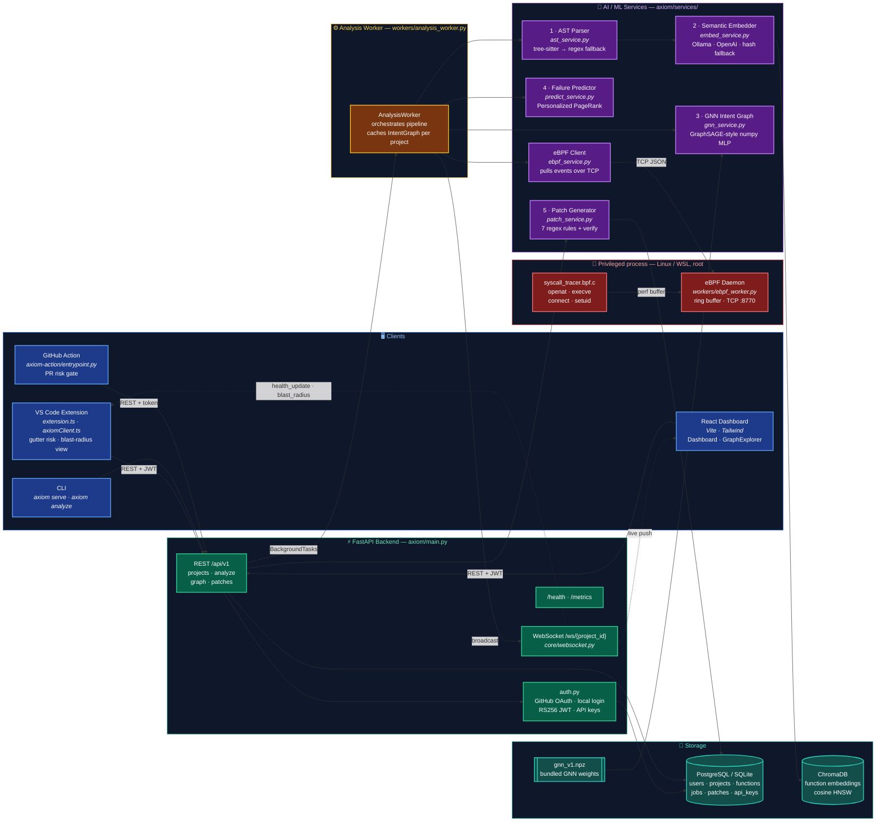
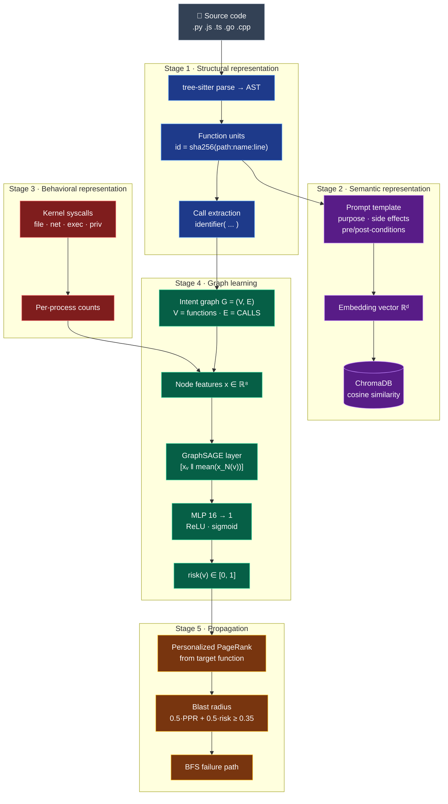
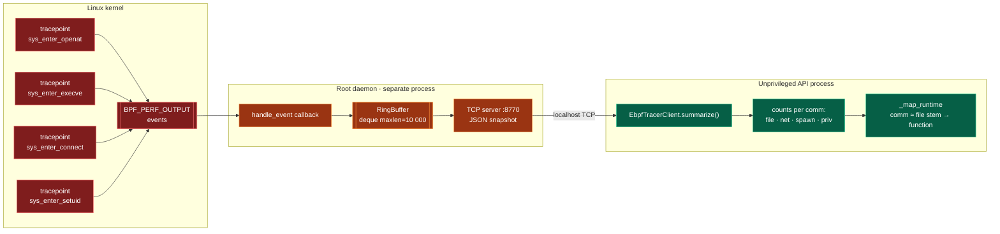
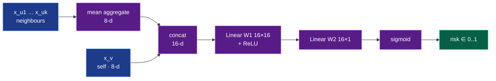
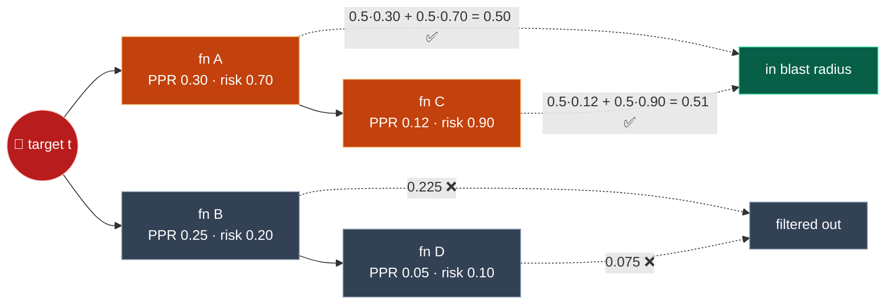
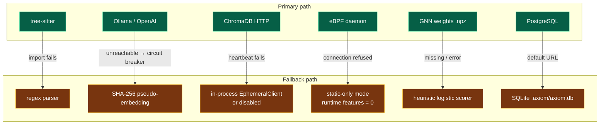
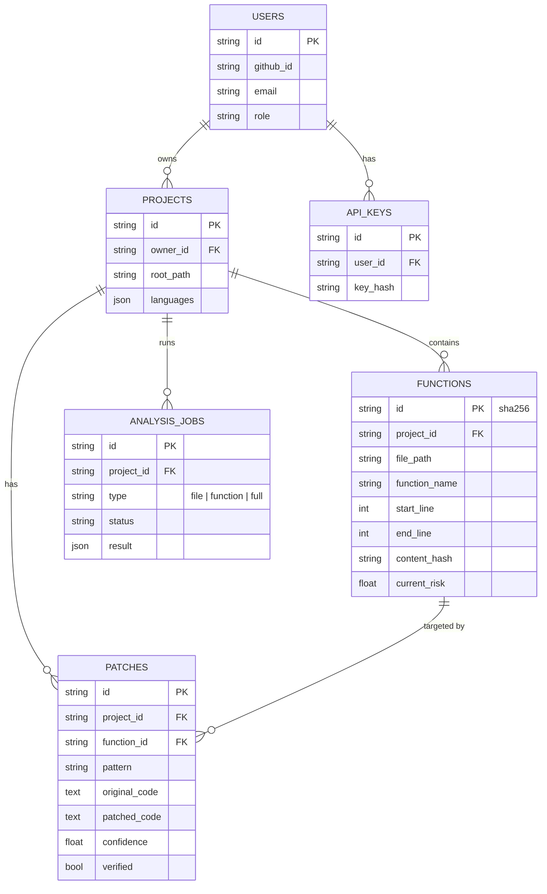
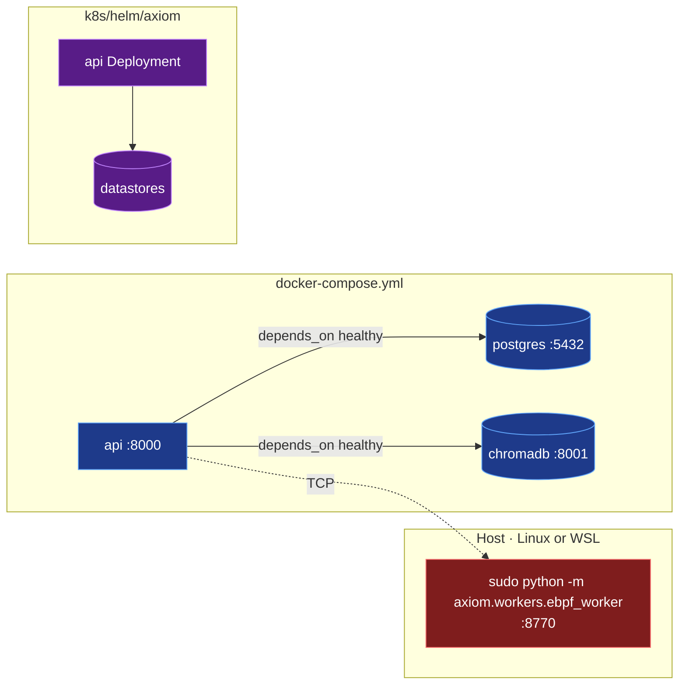

# AXIOM Architecture

This document explains how AXIOM is built and how it works, based on the code in this repository. It also covers the AI/ML ideas behind each stage.

AXIOM reads a codebase, splits it into functions, embeds each function as a vector, optionally adds live kernel telemetry from eBPF, builds a graph of functions, scores each function's risk with a small graph neural network, and predicts how a failure in one function could cascade to others ("blast radius"). It can also suggest template-based patches for 7 common vulnerability patterns.

---

## 1. System overview



**Color key:** 🔵 clients · 🟢 API layer · 🟠 orchestration · 🟣 AI/ML · 🔴 privileged kernel code · 🩵 storage.

---

## 2. End-to-end analysis flow

This is what happens when a user runs "Analyze Workspace" from VS Code.

```mermaid
sequenceDiagram
    autonumber
    actor Dev as Developer
    participant EXT as VS Code Extension
    participant API as FastAPI
    participant W as AnalysisWorker
    participant P as AST Parser
    participant E as Embedder
    participant C as ChromaDB
    participant T as eBPF Client
    participant D as eBPF Daemon
    participant G as GNN Engine
    participant WS as WebSocket

    Dev->>EXT: Analyze Workspace
    EXT->>API: POST /api/v1/analyze/workspace
    API->>API: verify JWT, load Project.root_path
    API->>W: BackgroundTasks.add_task(analyze_paths)
    API-->>EXT: 200 {job_id, status: queued}

    rect rgb(30, 58, 138)
    note over W,P: Stage 1 — Parse (thread pool)
    W->>W: collect_source_files (skip node_modules, build, minified)
    loop every source file
        W->>P: parse_file(path)
        P-->>W: ParsedFunction[] (name, lines, source, calls)
    end
    end

    rect rgb(88, 28, 135)
    note over W,C: Stage 2 — Embed
    loop every function
        W->>E: embed_text(build_prompt(fn))
        E-->>W: vector (768-d fallback, or model dim)
        W->>C: upsert(fn.id, vector, metadata)
    end
    end

    rect rgb(127, 29, 29)
    note over W,D: Stage 3 — Runtime fusion
    W->>T: summarize()
    T->>D: TCP connect :8770
    D-->>T: {"events": [...]} (or connection refused)
    T-->>W: per-process counts (empty = static-only mode)
    end

    rect rgb(6, 95, 70)
    note over W,G: Stage 4 — Graph + GNN (thread pool)
    W->>G: build_graph(functions, runtime)
    G->>G: nodes + CALLS edges
    G->>G: 8-d features → GraphSAGE forward → sigmoid
    G-->>W: IntentGraph with risk_score per node
    end

    W->>W: cache_graph(project_id)
    W->>WS: broadcast health_update {score, functions, elapsed_ms}
    WS-->>EXT: live update
    EXT->>API: GET /api/v1/graph/{project_id}
    API-->>EXT: nodes + edges
    EXT->>Dev: gutter risk decorations
```



---

## 3. The AI/ML pipeline, stage by stage



### Stage 1 — Parsing: code as a tree ([ast_service.py](axiom/services/ast_service.py))

**ML idea: structured input representation.** Raw text is a poor input for reasoning about code. An Abstract Syntax Tree (AST) exposes the grammar: which nodes are functions, where they start and end, and what they call.

- `tree-sitter` parses 5 languages: Python, JavaScript, TypeScript, Go and C++.
- The parser walks the tree and collects nodes of types such as `function_definition`, `method_definition` and `arrow_function`.
- Each function becomes a `ParsedFunction` with a stable ID: `sha256(file_path:name:start_line)`.
- Call names come from a regex over the function body (`\w+\s*\(`). Language keywords such as `if` and `for` are removed.
- **Fallback:** if tree-sitter is missing, per-language regexes find function headers. Each function is then given a fixed 20-line body.

### Stage 2 — Embedding: code as a vector ([embed_service.py](axiom/services/embed_service.py))

**ML idea: representation learning and semantic similarity.** An embedding model maps text to a point in ℝᵈ. Functions with similar meaning land close together, even when their names and syntax differ. Distance is cosine distance: `1 − (a·b)/(‖a‖‖b‖)`.

- Each function is wrapped in a prompt that asks for its purpose, external systems, preconditions and postconditions. The model embeds that prompt.
- Providers, tried in order: **Ollama** (`nomic-embed-text`, local) → **OpenAI** (`text-embedding-3-small`) → **hash fallback**.
- **Circuit breaker:** after the first provider failure, the run switches to the fallback. One missing Ollama does not cost N × timeout.
- The hash fallback is a deterministic SHA-256 vector of 768 dimensions. It is stable but has **no semantic meaning**. It only keeps the pipeline running.
- Vectors go into ChromaDB ([vector_store.py](axiom/services/vector_store.py)), a cosine HNSW index. HNSW (Hierarchical Navigable Small World) is an approximate nearest-neighbour graph. It finds the top-K similar vectors in roughly log time.

### Stage 3 — Runtime tracing: code as behaviour ([syscall_tracer.bpf.c](ebpf/syscall_tracer.bpf.c), [ebpf_worker.py](axiom/workers/ebpf_worker.py), [ebpf_service.py](axiom/services/ebpf_service.py))

**ML idea: multi-modal feature fusion.** Static code shows what a function *could* do. Kernel traces show what the process *actually* did. Combining both gives the model a richer signal than either one alone.



- The eBPF program hooks 4 kinds of syscalls and emits `{pid, tid, uid, ts_ns, etype, comm, arg}` records.
- The daemon runs as root in its **own process**. The API never loads BCC and never needs root.
- **Graceful degradation:** if the daemon is down, `fetch_events` returns `[]`. All runtime features become 0 and AXIOM runs in static-only mode.

### Stage 4 — Graph neural network: risk scoring ([gnn_service.py](axiom/services/gnn_service.py))

**ML idea: message passing on graphs.** A function's risk depends on its own code and on its neighbours. A function that calls `subprocess` with `shell=True` is risky. The functions that call it inherit part of that risk. A GNN learns this by mixing each node's features with its neighbours' features.

**Graph construction.** Nodes are functions. A `CALLS` edge goes from caller to callee when a call name matches a known function name.

**Node features (8 dimensions, each scaled to [0, 1]):**

| # | Feature | Source | Scaling |
|---|---|---|---|
| 0 | Lexical risk signal (`eval`, `pickle`, `shell=true`, `md5`, …) | static | sum of weights, ÷2, cap 1 |
| 1 | Lines of code | static | ÷100 |
| 2 | Fan-in (number of callers) | graph | ÷10 |
| 3 | Fan-out (number of callees) | graph | ÷10 |
| 4 | File accesses | eBPF | ÷10 |
| 5 | Network connects | eBPF | ÷10 |
| 6 | Process spawns | eBPF | ÷5 |
| 7 | Privilege changes | eBPF | ÷3 |

**Forward pass (one GraphSAGE layer with mean aggregation), in NumPy:**

```
h_N(v) = mean{ x_u : u ∈ N(v) }          # neighbours, edges treated as undirected
z      = [ x_v ‖ h_N(v) ]                # concatenate → 16-d
h      = ReLU(z · W1 + b1)               # W1: 16×16
risk   = σ(h · W2 + b2)                  # W2: 16×1, σ = sigmoid
```



- Weights live in `axiom/models/gnn_v1.npz` and are produced by [gen_gnn_weights.py](scripts/gen_gnn_weights.py).
- **Codebase health** = `1 − mean(risk)` over all nodes.
- **Fallback:** if the weights are missing or inference fails, a heuristic sums signal weights, adds `min(0.03 · fan_in, 0.2)`, and squashes with `σ(3 · (score − 0.5))`.

### Stage 5 — Failure prediction: blast radius ([predict_service.py](axiom/services/predict_service.py))

**ML idea: graph propagation and random walks.** Personalized PageRank (PPR) asks: "If a random walker starts at function *t* and keeps following call edges, restarting at *t* with probability α, how often does it visit each other function?" Functions with a high visit rate are the most exposed to a failure in *t*.

```
rank₀       = one-hot(t)
rankₖ₊₁(v) = α · 1[v = t] + (1 − α) · Σ_{u → v} rankₖ(u) · w(u,v) / Σ w(u,·)
α = 0.15, stop when the L1 change < 1e-6 or after 100 iterations
```



- Combined score = `0.5 · PPR + 0.5 · node_risk`. Results below 0.35 are dropped. The top 10 are returned.
- For each result, BFS finds the shortest call path from the target (max depth 6). This is shown to the user as the failure path.

*(The numbers in the diagram are illustrative.)*

### Stage 6 — Patch generation ([patch_service.py](axiom/services/patch_service.py))

**Approach: rule-based detection with self-verification.** No ML model is used here. Each of 7 rules has a detector regex, a rewrite function and a fixed confidence value.

| Pattern | Detects | Rewrite | Confidence |
|---|---|---|---|
| `sql_injection` | SQL keywords inside f-strings or concatenation | parameterized placeholder | 0.82 |
| `command_injection` | `shell=True`, `os.system(` | `shell=False`, `subprocess.run([...])` | 0.85 |
| `deserialization` | `pickle.loads`, `yaml.load` without a Loader | `json.loads`, `yaml.safe_load` | 0.80 |
| `path_traversal` | `open(` with `..`, `request.`, `input(`, `argv` | `realpath(join(SAFE_ROOT, basename(...)))` | 0.70 |
| `hardcoded_credentials` | credential variable = literal | `os.environ[...]` | 0.78 |
| `unchecked_null` | `.get(...).attr` | prepend a `None` guard | 0.60 |
| `race_condition` | `self.x +=` | wrap in a lock | 0.55 |

**Verification:** the patched code is checked again with the same detector. If it no longer matches, the patch is `verified=True`. This proves the pattern is gone. It does not prove the code still compiles or behaves the same.

---

## 4. Resilience: every stage has a fallback



The goal: `pip install axiom && axiom serve` works on a laptop with none of the optional services running.

---

## 5. Data model



Schema changes go through Alembic ([alembic/versions/](alembic/versions/)). The intent graph is **not** stored in the database. It lives in memory in `AnalysisWorker._graphs`, keyed by project. Embeddings live in ChromaDB.

---

## 6. Deployment topology



---

## 7. Current limits of the implementation

These are gaps between the PRD vision and what the code does today. They matter when you judge the ML results.

1. **The GNN is not trained on data.** [gen_gnn_weights.py](scripts/gen_gnn_weights.py) creates seeded random weights and then hand-biases the risk-related feature channels. The architecture is a real GraphSAGE layer, but the scores reflect hand-set priors, not learned patterns.
2. **Embeddings do not feed the GNN.** Vectors are stored in ChromaDB, but the 8 GNN features are lexical, structural and runtime counts only. Semantic similarity is not used in risk scoring yet. Only `CALLS` edges exist; there are no semantic edges.
3. **Call resolution is name-based.** `foo()` links to any function named `foo`. If two functions share a name, the last one parsed wins. Method calls such as `obj.foo()` match by bare name.
4. **Runtime mapping is coarse.** eBPF counts are linked to functions when the process name (`comm`) and the file name overlap. This is a substring match, not stack-based resolution.
5. **`called_by` is never filled in**, so the embedding prompt always says "Called by: none".
6. **Patch verification is shallow.** It confirms the regex no longer matches. It does not run tests or check syntax. Several rewrites (`race_condition`, `unchecked_null`, `sql_injection`) produce code that needs manual editing before it runs.
7. **Graphs are in memory only.** A server restart loses all analysis results until a re-scan.

### Security notes found while reading the code

- **Source code is sent to the embedding provider.** `build_prompt` puts up to 50 lines of function source into the prompt. With `AXIOM_EMBED_PROVIDER=openai`, that text goes to `api.openai.com`. This conflicts with Critical Rule #1 in [CLAUDE.md](CLAUDE.md) ("only embeddings go out"). `AXIOM_AIR_GAPPED=true` blocks it. Ollama runs locally, so it is not affected.
- **`POST /api/v1/patches/{project_id}/generate` reads any path the server can read.** `file_path` is not checked against the project's `root_path`. Auth is off by default in local mode, so any local process can read files through it, and the contents are stored in the `patches` table.

---

## 8. File map

| Layer | Files |
|---|---|
| Entry points | [axiom/main.py](axiom/main.py), [axiom/cli.py](axiom/cli.py) |
| API routers | [axiom/api/](axiom/api/) — `auth`, `projects`, `analysis`, `graph`, `patches`, `health` |
| Core | [axiom/core/](axiom/core/) — `config`, `database`, `security`, `websocket` |
| AI/ML services | [axiom/services/](axiom/services/) — `ast_service`, `embed_service`, `vector_store`, `gnn_service`, `predict_service`, `patch_service`, `ebpf_service` |
| Workers | [axiom/workers/analysis_worker.py](axiom/workers/analysis_worker.py), [axiom/workers/ebpf_worker.py](axiom/workers/ebpf_worker.py) |
| Kernel probe | [ebpf/syscall_tracer.bpf.c](ebpf/syscall_tracer.bpf.c) |
| Models | [axiom/models/](axiom/models/) — `db_models`, `api_models`, `gnn_v1.npz` |
| Dashboard | [dashboard/src/](dashboard/src/) — `Dashboard`, `GraphExplorer`, `ForceGraph` |
| VS Code extension | [vscode-extension/src/](vscode-extension/src/) — `extension`, `axiomClient`, `RiskDecorations`, `RiskViewProvider` |
| CI | [axiom-action/](axiom-action/), [.github/workflows/](.github/workflows/) |
| Deploy | [docker-compose.yml](docker-compose.yml), [Dockerfile](Dockerfile), [k8s/helm/axiom/](k8s/helm/axiom/) |
